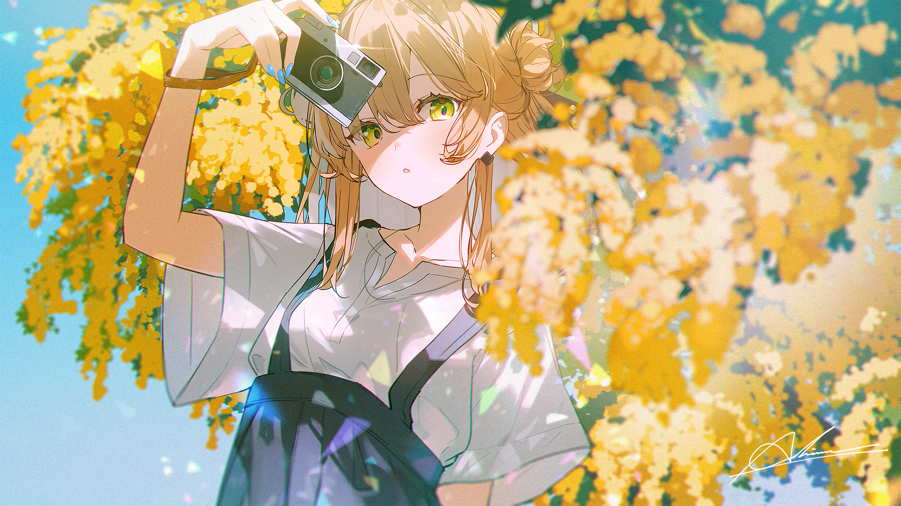

 

# Drawrain

### `CTF` · `Reverse` · `AI`

黄色的树林里分出两条路，

可惜我不能同时去涉足. 

只愿自己不再美化自己没走过的那条路

 

---

## 🧰 Tech stack

---

## 🐍 Contributions

<picture>
  <source media="(prefers-color-scheme: dark)" srcset="https://raw.githubusercontent.com/Drawrain39/Drawrain39/output/github-contribution-grid-snake-dark.svg" />
  <source media="(prefers-color-scheme: light)" srcset="https://raw.githubusercontent.com/Drawrain39/Drawrain39/output/github-contribution-grid-snake.svg" />
  
</picture>

---

### 𓂃 ࣪˖ ִֶָ🌼 この先どうなら楽ですか。

今后该怎么样 才能活的轻松呢.

